Week 03 - Company Profile Website (Laravel)


1. Project Title

Company Profile Website - BrightPath Digital Solutions

A responsive multi-page company profile website built with Laravel using the MVC architecture. BrightPath Digital Solutions is a fictional IT startup based in Calamba City, Laguna, created for this activity.


2. Introduction

What is a Company Profile Website?
A company profile website is an online presentation of a business. It tells visitors who the company is, what it offers, and how to contact it. Common pages are Home, About, Services, and Contact.

Why do businesses need one?
Most customers search online before they decide to buy or hire. A company profile website builds trust, shows the services offered, makes the business easy to find, and works as an official online presence that is available 24/7.

Purpose of the project
The purpose of this project is to apply the basics of Laravel: routing, controllers, and Blade templates. The website shows how a request travels from the browser to a route, to a controller, and finally to a view, while using reusable layouts and components.


3. Objectives

- Build a responsive four-page website (Home, About, Services, Contact) using Laravel.
- Configure routes in routes/web.php and give each route a name.
- Create CompanyController with home(), about(), services(), and contact() methods.
- Use reusable Blade layouts and components so the navbar and footer are not duplicated.
- Style the website with Tailwind CSS to make it clean, responsive, and professional.
- Use Git and GitHub with at least 8 meaningful commits.
- Document the project and explain the MVC flow.


4. MVC Architecture

What is MVC?
MVC stands for Model, View, Controller. It is a way of organizing an application into three parts:
- Model handles data and business rules (usually the database).
- View is what the user sees (the HTML page).
- Controller receives the request, gets the needed data, and chooses the view to return.

Why does Laravel use MVC?
Laravel uses MVC so that the code stays organized and each part has one clear job. Routes decide where a request goes, controllers hold the logic, and Blade views handle the display. This makes Laravel projects easier to read, test, and maintain.

Advantages of MVC in software development
- Code is organized and easy to find.
- Changes in one part rarely break the others.
- Several developers can work on different parts at the same time.
- Views and logic can be reused.
- It is easier to test and to grow the application.

This project has no database, so it does not use a Model yet. The services and team data are stored in CompanyController.

Request flow diagram

```text
Browser
   │
   ▼
Route (routes/web.php)
   │
   ▼
CompanyController
   │
   ▼
Blade View
   │
   ▼
Response to Browser
```

The architecture diagram image is saved in the documentation/ folder.


5. Laravel Routing

What is Routing?
Routing connects a URL to the code that should handle it. In Laravel, routes are written in routes/web.php.

GET Requests
A GET request is sent when a browser opens a page or clicks a link. All four routes in this project use Route::get() because they only display pages.

Route Definitions

```php
Route::get('/', [CompanyController::class, 'home'])->name('home');
Route::get('/about', [CompanyController::class, 'about'])->name('about');
Route::get('/services', [CompanyController::class, 'services'])->name('services');
Route::get('/contact', [CompanyController::class, 'contact'])->name('contact');
```

Named Routes
A named route gives a route a name using ->name('about'). Links can then use route('about') instead of a hard-coded URL, so if the URL changes, the links still work. The navbar uses named routes.

Screenshot of routes/web.php

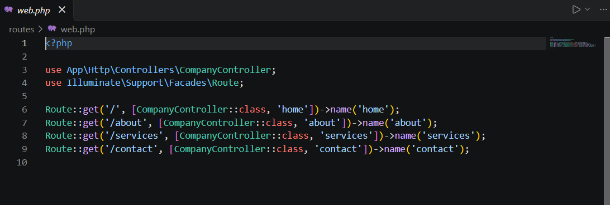


6. Controllers

Purpose of Controllers
A controller receives a request from a route, prepares the data, and returns a response, usually a view.

Benefits of Controllers
- They keep logic out of the route file and out of the views.
- Related actions are grouped in one class.
- They are easier to reuse and to test.

Controller Methods
CompanyController has four methods, and each returns the matching Blade view:
- home() returns pages.home and passes three featured services.
- about() returns pages.about and passes the team members.
- services() returns pages.services and passes all six services.
- contact() returns pages.contact.

Screenshot of CompanyController.php

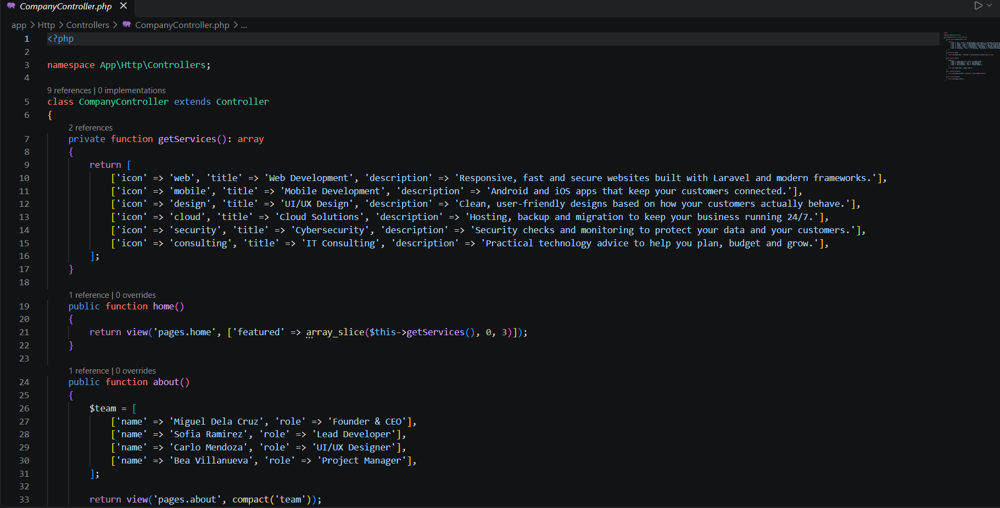


7. Blade Templating Engine

Blade is Laravel's templating engine. It lets us write HTML together with simple directives and reuse parts of a page.

Blade Layouts
resources/views/layouts/app.blade.php is the main layout. It holds the <head>, the navbar, the footer, and a place where each page's content is inserted.

Blade Components
navbar.blade.php and footer.blade.php in resources/views/components/ are reusable components, used in the layout as <x-navbar /> and <x-footer />. There is also a small icon component that draws the SVG icons.

Directives
- @extends('layouts.app') makes a page use the main layout.
- @section('content') ... @endsection defines the content that the page sends to the layout.
- @yield('content') is the place in the layout where the section is displayed.
- @include('...') inserts another Blade file into a view. This project uses <x-navbar /> and <x-footer /> component tags for the same purpose.

Sample code: layout

```blade
<body>
    <x-navbar />

    <main>
        @yield('content')
    </main>

    <x-footer />
</body>
```

Sample code: page

```blade
@extends('layouts.app')
@section('title', 'Services | BrightPath Digital Solutions')

@section('content')
    <h1>Our Services</h1>
@endsection
```

Screenshot of the Blade layout

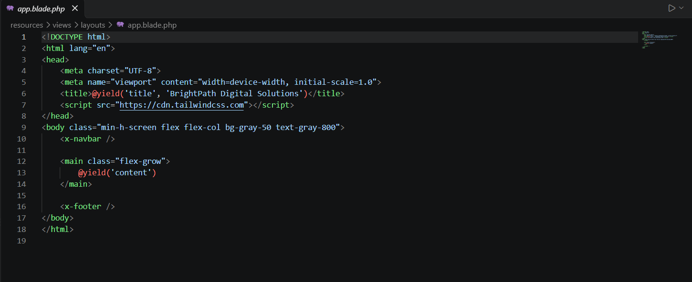


8. Laravel Folder Structure

- app/ holds the main application code, such as controllers and models. In this project, CompanyController.php is in app/Http/Controllers/.
- routes/ holds the route files. web.php defines the website's URLs.
- resources/ holds the views (Blade templates), CSS, and JavaScript. All pages and components are in resources/views/.
- public/ is the folder the web server serves. It contains index.php, the entry point of every request, and public files such as images.
- bootstrap/ starts the framework. It contains app.php and the cache folder.
- config/ holds the configuration files, such as app, database, and session settings.

Project structure

```text
week03-company-profile/
├── app/Http/Controllers/CompanyController.php
├── resources/views/
│   ├── layouts/app.blade.php
│   ├── components/ (navbar, footer, icon)
│   └── pages/ (home, about, services, contact)
├── routes/web.php
├── public/
├── screenshots/
├── documentation/
└── README.md
```


9. Screenshots

Home Page

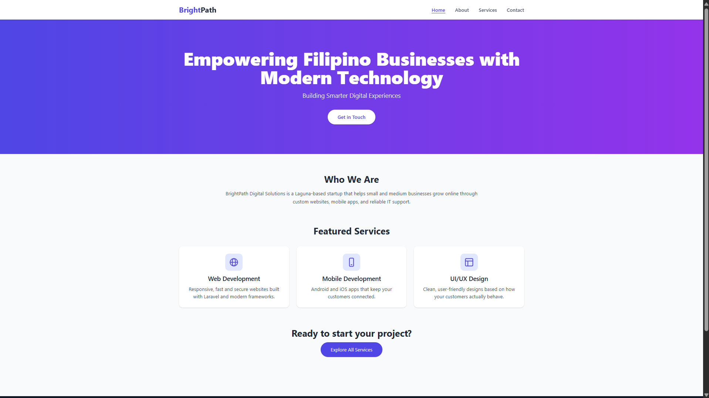

About Page

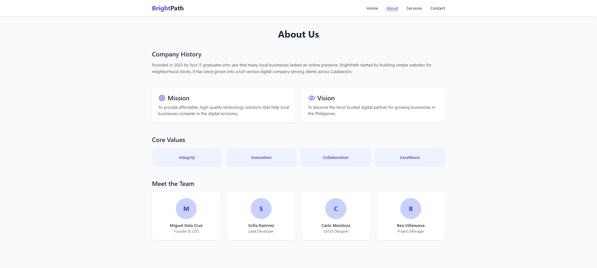

Services Page

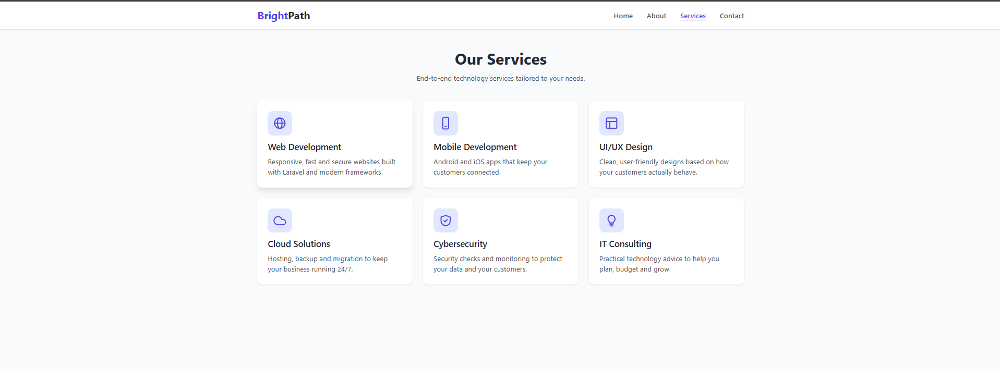

Contact Page

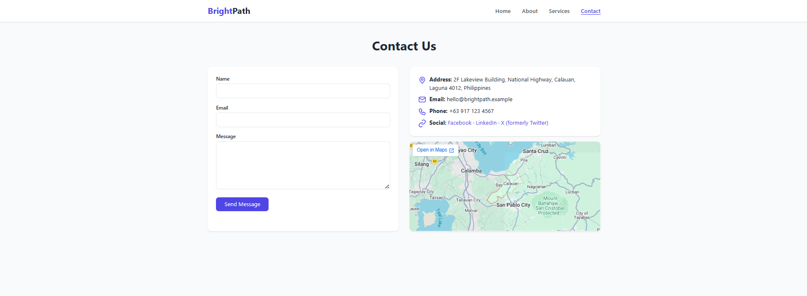

Navigation Bar


Footer


Route Definitions


Controller


Blade Layout


VS Code Project

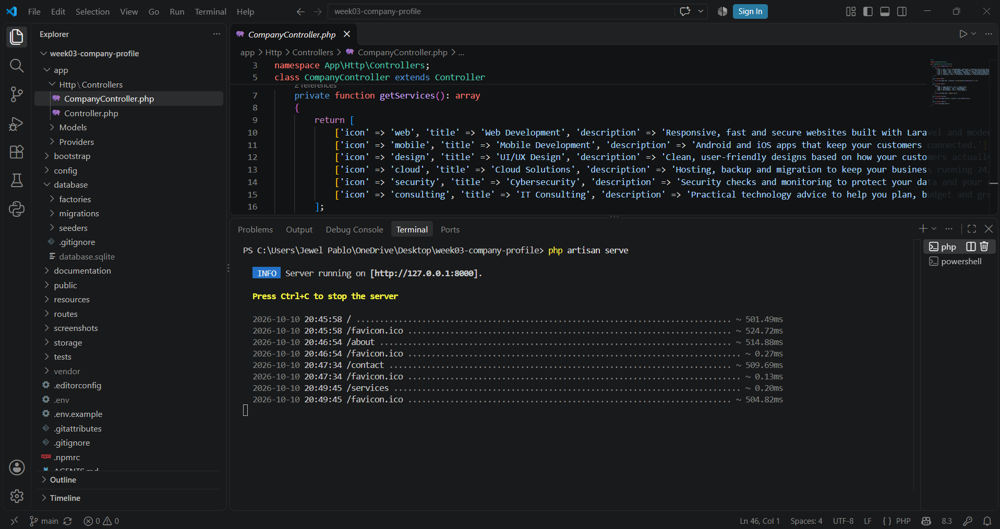

Laravel Folder Structure

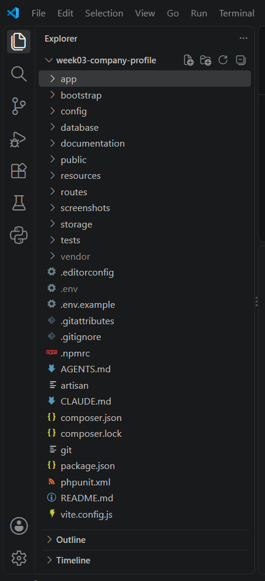

GitHub Repository

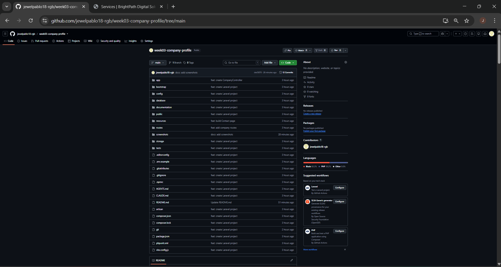

Browser Output

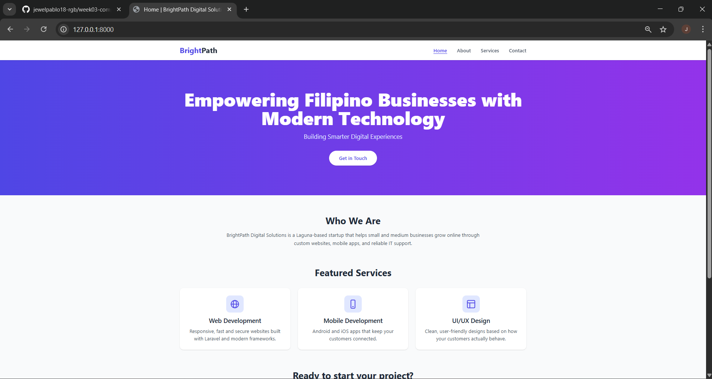

10. Problems Encountered

1. 'php' is not recognized error. When I ran php -v in the terminal, Windows could not find PHP.
2. Could not open input file: artisan error. php artisan serve failed because I ran it in the wrong folder, one that was not a full Laravel project.
3. Cannot redeclare CompanyController::services() error. The app crashed with a fatal error pointing to the services() method in the controller.


11. Solutions

1. PHP not recognized. PHP was not installed. I installed PHP and Composer from the terminal, then closed and reopened VS Code so the terminal could read the new PATH. After that, php -v and composer -V showed their versions.
2. Artisan not found. The folder I used only contained my own files (routes, controller, and views). I created a real project with composer create-project laravel/laravel week03-company-profile, copied my files into it, and ran php artisan serve from inside the new project folder.
3. Cannot redeclare services(). I had two methods with the same name in one class: a private helper that held the list of services and the public method that returned the view. PHP does not allow this. I renamed the private helper to getServices() and updated the two places that called it. The services() route method stayed the same.


12. Reflection

Building this Company Profile Website helped me understand MVC in a practical way. Before this project, MVC was only a definition I had memorized. Now I can see that each part has its own job: the route receives the request, the controller prepares the data, and the Blade view decides how it looks in the browser. This project has no database, so there is no Model yet, but the idea of dividing responsibilities already showed up. The list of services and team members lives in CompanyController, while the pages only display it using loops.

Separation of concerns is important because it keeps code easy to find, change, and reuse. When I needed to update the address in the footer, I edited one file, footer.blade.php, and all four pages changed. Without reusable layouts, I would have repeated the navbar and footer on every page and fixed the same thing four times. It also makes bugs easier to locate, because a layout problem points to a view, while a wrong value points to the controller. It lets people work at the same time too, for example a designer on the views and a developer on the controllers.

Routes, controllers, and views work together like a chain. When a visitor opens /services, the route in web.php matches the URL and calls the services() method of CompanyController. The method returns view('pages.services'), and Laravel wraps that page inside layouts/app.blade.php using @extends and @yield, then sends the finished HTML to the browser. Every request follows the same predictable path. Named routes kept this clean, because the navbar uses route('about') instead of hard-coded URLs.

I also learned from my mistakes. The error "Cannot redeclare services()" taught me that method names in a class must be unique and that error messages point to the exact line. Setting up PHP, Composer, and Laravel showed me that the environment is part of development work. Committing in small steps with Git made the project history easy to follow.

This architecture can scale to larger enterprise systems. The same flow remains, but there are more routes, controllers grouped by feature, models connected to a database, middleware for login and permissions, and reusable components. Teams can divide work by layer, test each part separately, and add features without rewriting existing ones. Larger systems also need testing and clear folder organization, which this project helped me practice. I now see this small project as a foundation for bigger systems, such as an online shop or a school portal.


13. References

Laravel. (n.d.). Laravel documentation. https://laravel.com/docs

Mozilla. (n.d.). MDN web docs. https://developer.mozilla.org/

Tailwind Labs. (n.d.). Tailwind CSS documentation. https://tailwindcss.com/docs

The PHP Documentation Group. (n.d.). PHP manual. https://www.php.net/manual
